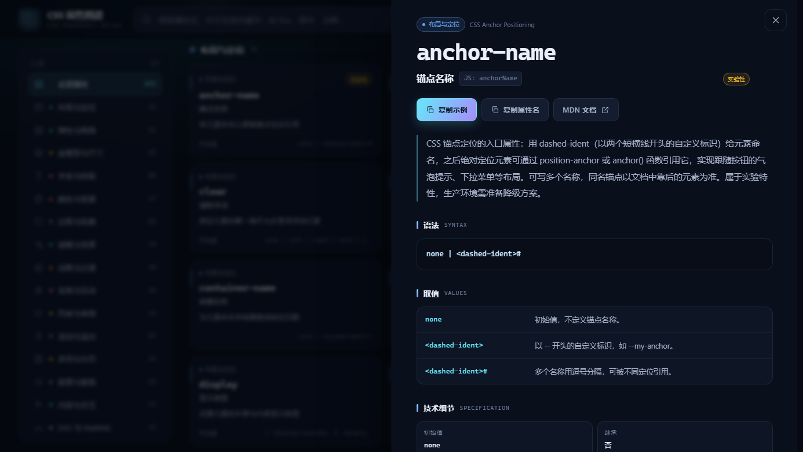
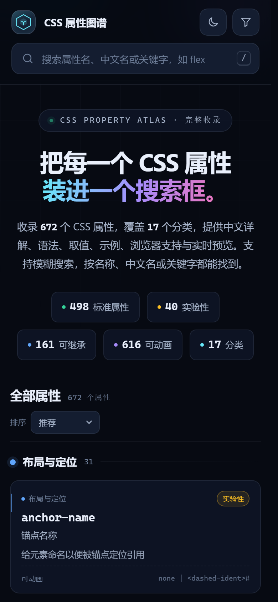
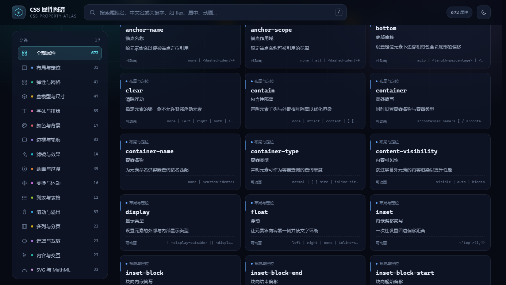

# CSS 属性图谱 · CSS Property Atlas

一个**纯静态、多文件、可离线打开**的 CSS 属性查找器。收录 **672 个 CSS 属性**，覆盖 17 个分类，每个属性都包含中文名称、作用说明、语法、取值、初始值、继承性、动画类型、示例代码、实时预览与浏览器支持。


## 快速开始

### 方式一：直接打开（推荐）

双击 `index.html` 即可。页面使用传统 `<script>` 加载本地数据，**不需要服务器**，`file://` 协议下也能正常搜索和查看详情。

### 方式二：本地静态服务器（可选）

如果希望使用 http 协议或部署到服务器：

```powershell
# 任选一种
python -m http.server 8080
npx serve .
```

然后访问 `http://localhost:8080/`。

## 功能特性

- **全量属性库**：672 个属性，包含 498 个标准属性、40 个实验性属性、119 个非标准属性和 15 个已废弃属性；覆盖 WebKit / Mozilla / Microsoft 私有前缀与 SVG、MathML 属性。
- **精准 + 模糊搜索**：按英文属性名、JS 驼峰名、中文名、别名、关键字、描述、语法、取值、分类、状态搜索；支持英文子序列缩写（`bgc` → `background-color`）、拼写容错（`dispaly` → `display`）和中文关键词（`居中`、`圆角`、`背景`）。
- **分类与筛选**：17 个分类、4 种状态、可继承 / 可动画 / 逻辑属性标签筛选，支持分类浏览、A-Z、状态优先排序。
- **详细属性页**：语法、取值逐项解释、技术细节（初始值、继承、动画、百分比、适用元素、计算值）、示例代码、`.demo` 结构实时预览、注意事项、相关属性、浏览器支持（Chrome / Firefox / Safari / Edge）。
- **优质阅读体验**：深色 / 浅色主题、响应式布局（桌面 / 平板 / 手机）、快捷键、URL 深链接（`#/display`）、复制代码、回到顶部。
- **完全多文件**：4 个 CSS 文件、4 个 JS 模块、6 个数据分片，样式、逻辑与数据解耦，便于二次开发。

## 目录结构

```text
网页版CSS查找/
├─ index.html                 # 页面骨架
├─ css/
│  ├─ tokens.css              # 设计变量、深/浅主题与分类色板
│  ├─ base.css                # 重置、排版、无障碍、背景装饰
│  ├─ layout.css              # 顶栏、首屏、侧栏、内容区、详情抽屉、响应式
│  └─ components.css          # 搜索框、筛选、卡片、代码块、预览、Toast
├─ js/
│  ├─ search.js               # 多字段加权搜索、子序列模糊匹配、拼写容错
│  ├─ preview.js              # 示例的沙箱 iframe 实时预览
│  ├─ render.js               # 卡片、分类分组、详情面板 HTML 渲染
│  └─ app.js                  # 状态、筛选、交互、主题、键盘与路由
├─ data/
│  ├─ meta.js                 # 分类、状态与统计元数据（自动生成）
│  ├─ properties-01.js ~ 06.js# 属性数据分片（自动生成，页面加载）
│  └─ properties.json         # 完整属性数据（JSON，便于二次利用）
├─ assets/
│  └─ favicon.svg
├─ screenshots/               # 预览截图
├─ tools/
│  └─ split-data.js           # 将 properties.json 重新拆分为 6 个分片
└─ README.md
```

## 搜索与快捷键

| 操作 | 说明 |
| --- | --- |
| `/` 或 `Ctrl/⌘ + K` | 聚焦搜索框 |
| `↑` / `↓` | 在搜索建议或属性卡片间移动 |
| `Enter` | 打开当前高亮项 / 搜索结果的第一个属性 |
| `Esc` | 关闭详情 → 关闭搜索建议 → 清空搜索 |
| 点击属性卡片 | 打开详情抽屉 |
| 详情页 URL | `index.html#/display` 可直接分享到某个属性 |

搜索会依次匹配：属性名 → 中文名 / 别名 → 关键字 → 描述 → 语法 / 初始值 / 取值 → 分类 / 状态 / 标签。多个关键词用空格分隔（如 `flex 居中`），结果按相关度排序。

## 数据说明

- 属性基础字段（语法、初始值、继承性、动画类型、百分比、适用元素、计算值、浏览器支持、MDN 链接）来自 MDN 的 [mdn-data](https://github.com/mdn/data) 与 [Browser Compat Data](https://github.com/mdn/browser-compat-data)。
- 中文名称、详细说明、别名、关键字、取值解释、示例与注意事项为人工整理内容。
- 收录范围以 MDN CSS Reference 为标准，包含标准、实验性、非标准、已废弃以及浏览器私有前缀属性；不含从未进入浏览器实现的早期草案属性。
- 浏览器支持中的数字表示首次支持该属性的版本；`—` 表示兼容数据缺失；`不支持` 表示明确不支持。属性是否可用仍建议以目标浏览器实测为准。

数据字段示例：

```json
{
  "name": "background-color",
  "js": "backgroundColor",
  "zh": "背景颜色",
  "category": "color",
  "categoryName": "颜色与背景",
  "status": "standard",
  "statusLabel": "标准",
  "summary": "设置元素背景的填充颜色",
  "description": "……",
  "aliases": ["背景色", "底色", "bg-color"],
  "keywords": ["颜色", "填充", "透明"],
  "values": [{ "v": "<color>", "d": "任意合法颜色值。" }],
  "example": ".demo {\n  background-color: #ff6b6b;\n}",
  "notes": ["背景色位于背景图之下。"],
  "syntax": "<color>",
  "initial": "transparent",
  "inherited": "否",
  "animation": "颜色插值",
  "percentages": "不适用",
  "appliesTo": "所有元素",
  "computed": "计算后的颜色值",
  "browser": { "chrome": "1", "firefox": "1", "safari": "1", "edge": "12" },
  "tags": ["可动画"],
  "mdn": "https://developer.mozilla.org/..."
}
```

## 二次开发

### 修改属性数据

1. 编辑 `data/properties.json`（完整数据，按分类排序）。
2. 运行拆分脚本（仅需 Node.js，无需安装依赖）：

```powershell
node tools/split-data.js
```

脚本会重新生成 `data/meta.js` 与 `data/properties-01.js ~ 06.js`，刷新页面即可看到变化。

### 调整主题与分类色

- 颜色、圆角、字体、间距变量集中在 `css/tokens.css`。
- 分类配色在 `css/tokens.css` 的 `--cat-*` 变量与 `js/render.js` 的 `CAT_COLORS` 中同步维护。

### 新增分类

在 `tools/split-data.js` 的 `CATEGORIES` 中追加分类（`id`、`name`、`icon`、`desc`），并在 `index.html` 的 SVG symbol 中补充对应图标，然后重新运行拆分脚本。

## 浏览器支持

页面使用现代 CSS（`color-mix()`、`backdrop-filter`、CSS 变量、Grid、`clamp()`）与原生 ES2017+，建议使用最新版 Chrome / Edge / Firefox / Safari。旧版浏览器可正常查看内容，但毛玻璃、部分渐变等视觉效果会降级。

## 截图

| 详情页 | 移动端 |
| --- | --- |
|  |  |

滚动浏览时，顶部的“全部属性”标题栏会随页面滚走，不会悬浮遮挡卡片：



---

数据整理自 MDN 与 W3C 规范，仅供学习与开发参考。
